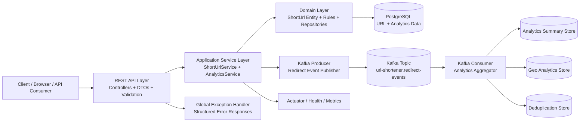

# Architecture Overview

## Layered architecture
The application follows a standard Spring Boot layered design:

1. API layer
   - REST controllers
   - request validation
   - response serialization
   - exception translation

2. Application layer
   - business services
   - orchestration logic
   - domain rules
   - validation and transformation of data for persistence

3. Domain layer
   - domain entities
   - repositories
   - core business semantics
   - analytics/deduplication concepts

4. Infrastructure layer
   - Kafka producer and consumer
   - external integration concerns
   - persistence adapters
   - event processing logic

## Why this structure fits the project
- The API layer stays thin and handles HTTP concerns.
- Business logic remains centralized in service classes.
- Domain models represent the short URL and analytics state explicitly.
- Kafka lives in infrastructure to keep event processing isolated from business rules.

## System architecture diagram

## Data flow
- Client sends create/update/read/redirect requests to the controller.
- Controller delegates to application services.
- Services validate domain constraints and persist to PostgreSQL.
- Redirect requests emit analytics events to Kafka.
- Consumer processes events and updates summary and geo aggregation records.

## Review note
This architecture is acceptable for the current scope, but any expansion into auth, billing, admin workflows, or multi-tenant routing would require a new design review.
